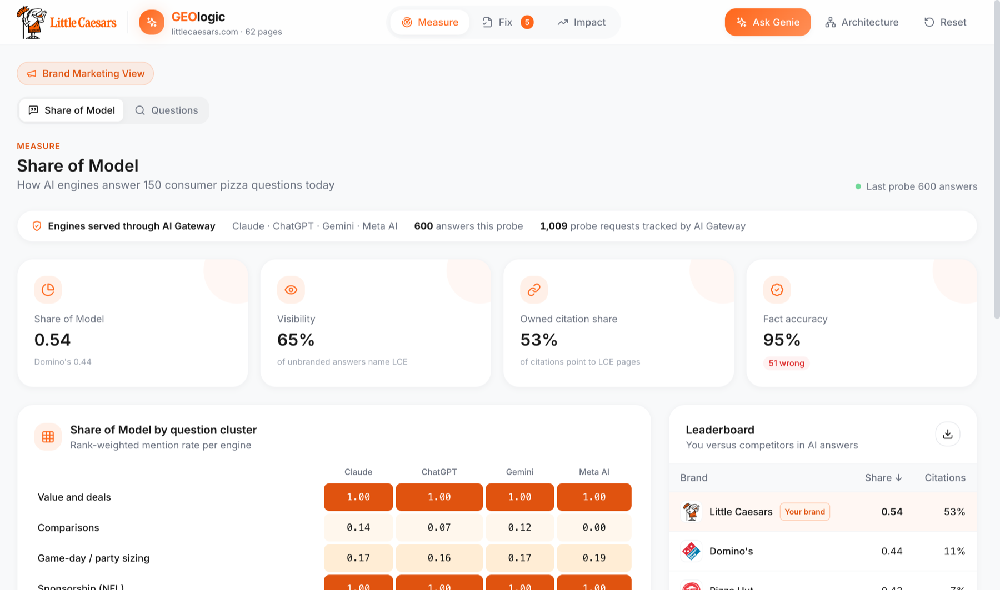
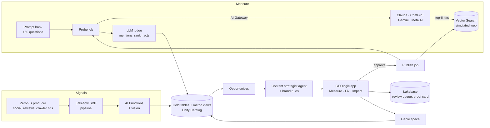

<p align="center">
  
</p>

<h1 align="center">GEOlogic</h1>

<p align="center">
  <b>When a guest asks an AI "what's the best bang for my buck pizza?", make sure the answer is Little Caesars, with the right facts.</b><br>
  A Generative Engine Optimization (GEO) demo on Databricks: measure what four AI answer engines say about the brand, fix the gaps with governed content, and prove the lift.
</p>

<p align="center">
  
  
  
  
  
  
  
</p>

<p align="center">
  
</p>

> [!IMPORTANT]
> **This is a demo built by Databricks for Little Caesars. It contains no Little Caesars customer or company data.** Every menu item, web page, review, social post, prompt volume and metric in this repo is synthetic, generated by the code in `src/geologic/datagen`. It is not a Little Caesars product and is not endorsed by Little Caesars. Brand names and logos belong to their owners; athlete names refer to Little Caesars' public NFL sponsorship, and every post attributed to them here is made up.

---

## ✨ What it does

| Tab | What you get |
|---|---|
| **Measure** | A scoreboard of how four AI engines (Claude, ChatGPT, Gemini and Meta AI) answer 150 consumer pizza questions: **Share of Model** (rank-weighted mention score), visibility, owned citation share and fact accuracy, broken out by engine and question cluster, plus a competitor leaderboard. **Questions** drills into each prompt, its monthly volume and every engine's answer. |
| **Fix** | Opportunities ranked by expected lift, each with its evidence (the answers, citations and wrong claims behind it) and a fix drafted by a content strategist agent and checked by brand rules. Approve one and GEOlogic publishes it to the simulated web, re-indexes it and re-asks the engines. |
| **Impact** | The before and after for the last published fix (same question, same engine), stored in Lakebase, with weekly Share of Model against Domino's and an autonomy strip (auto-published, human-reviewed, blocked). |
| **Ask Genie** | A slide-over on every tab. Ask follow-up questions in plain English and see live phases, the generated SQL, a table and a chart. |

**The demo payoff:** the top opportunity is *Answer game day party questions*. Approve it and game-day Share of Model goes from about **0.08 to 0.19**, live, because the engines now find the new party FAQ.

## 🏗️ How it works



Databricks-hosted models don't browse the web and don't know the synthetic menu, so each engine answers through retrieval over a **simulated web**: a Vector Search index of synthetic Little Caesars pages, competitor pages, Reddit threads, reviews and news. Publishing a fix changes that corpus, so the before and after comes from the real system, not from scripted output.

## 🚀 Quick start

Everything deploys as one Declarative Automation Bundle (`databricks.yml` plus `resources/*.yml`) through `scripts/deploy.sh`. A few pieces are provisioned once by hand (Lakebase, Zerobus, Genie, Supervisor); [First-time setup](#first-time-setup) walks through them in order.

**Prerequisites**

- [Databricks CLI](https://docs.databricks.com/dev-tools/cli/install.html) v1.x, authenticated: `databricks auth login --profile DEFAULT`
- Node 18+ and npm (the frontend is built locally; only `app/frontend/dist` ships)
- `python3` and `rsync` (used by `scripts/deploy.sh`)
- A workspace with Databricks Apps, serverless compute, Lakebase, Vector Search, AI Gateway, Genie and Agent Bricks

```bash
git clone https://github.com/jonathan-whiteley/geologic.git && cd geologic
bash scripts/deploy.sh               # build frontend, bundle src, validate, plan, deploy, start the app
SKIP_BUILD=1 bash scripts/deploy.sh  # reuse the existing app/frontend/dist
```

> [!WARNING]
> **Always deploy with `scripts/deploy.sh`.** A bare `databricks apps deploy` skips the env in `resources/app.yml` `config.env`, and the app starts without its catalog, Genie space or Lakebase settings.

What the script does:

1. Builds the frontend (`npm ci && npm run build`).
2. Copies `src/geologic` into `app/src` (the app imports the bundled copy).
3. Runs `bundle validate --strict` and `bundle plan`, and refuses to deploy (`scripts/check_plan.py`) if the plan is empty, deletes or recreates anything, or (when the live app exists) would create one of the adopted resources, which means the checkout is not bound yet.
4. Runs `bundle deploy`, then checks that the built `dist` assets landed in the app source path (imports them explicitly if not).
5. Runs `bundle run geologic`, which deploys the app snapshot with its env.

<a id="deploy-your-own"></a>

## 🔧 Deploy to your own workspace, catalog and schema

> [!IMPORTANT]
> **The committed defaults point at the reference demo workspace** (profile `DEFAULT`, catalog `jdub_demo`, schema `geologic`, plus its warehouse, Lakebase host, app service principal and Genie space). Change them before you deploy anywhere else.

| Setting | Where | What to set |
|---|---|---|
| `catalog`, `schema` | `databricks.yml` variables **and** `src/geologic/config.py` | A schema you can create tables, volumes and functions in |
| `warehouse_id` | `databricks.yml` (or `WAREHOUSE_ID=` for `deploy.sh`) | A serverless SQL warehouse you can use |
| `lakebase_host` | `databricks.yml` (or `LAKEBASE_HOST=`) **and** `src/geologic/lakebase.py` `LAKEBASE_DEFAULTS` | `read_write_dns` of your Lakebase instance |
| `app_sp_client_id` | `databricks.yml` (or `APP_SP_CLIENT_ID=`) | The app's service principal, known after the first deploy |
| `genie_space_id` | `databricks.yml` | The Genie space you create from `genie/space.json` |
| `supervisor_endpoint` | `databricks.yml` (or `SUPERVISOR_ENDPOINT=`) | Optional: only the API-only `POST /api/ask` route uses it |
| Workspace profile | `databricks.yml` `targets.dev.workspace.profile` and `PROFILE` in `scripts/deploy.sh` | Your CLI profile |
| Dashboard folder | `resources/dashboard.yml` `parent_path` | A workspace folder you own |

Jobs don't receive bundle variables; they read the code defaults in `src/geologic/config.py` and `src/geologic/lakebase.py`. The dashboard JSON, the `sql/*.sql` files and `jobs/run_views.py` also name `jdub_demo.geologic` directly, so search and replace it.

<a id="first-time-setup"></a>

### First-time setup in a fresh workspace

Do these in order.

1. **Lakebase.** Create the Lakebase instance `geologic` and apply `sql/lakebase_schema.sql` to its `geologic` database. Note its `read_write_dns`. The schema includes `proof_results`, the Impact tab's proof card: the app writes a row when a publish completes, and Reset does not clear it.
2. **Zerobus.** Create a service principal for Zerobus ingest, grant it access to `<catalog>.<schema>.bronze_signals`, and store `zb_endpoint`, `zb_client_id` and `zb_client_secret` in the secret scope `geologic` (read by `src/geologic/producer.py`).
3. **Point the code at your workspace** (see the table above).
4. **Deploy:** `bash scripts/deploy.sh`. A new app gets a new service principal; read it with `databricks apps get geologic -o json` (`service_principal_client_id`), set `app_sp_client_id`, then redeploy.
5. **Grants for the app's service principal:**
   - Lakebase: `CAN_USE` on the instance; create the SP Postgres role, then grant `USAGE` on the schema, `SELECT, INSERT, UPDATE, DELETE` on its tables and `USAGE, SELECT` on its sequences.
   - Unity Catalog: `USE CATALOG`; `USE SCHEMA, SELECT, EXECUTE` on the schema; `READ VOLUME` on `<schema>.assets`; `MODIFY` on `<schema>.tracked_prompts`; `SELECT` on `<schema>.prompt_idx`.
   - `CAN_USE` on the SQL warehouse.
   - `CAN_RUN` on the Genie space ACL (step 9; Genie spaces aren't bindable app resources).
6. **Build the demo:** `databricks bundle run geologic_setup` (30 to 40 minutes). It generates the reference data, images, simulated web corpus, Vector Search indexes, AI Gateway routes, the baseline probe, the SQL views, themes, opportunities and the draft queue.
7. **SQL objects** (run on the warehouse): `sql/public_views.sql`, `sql/uc_functions.sql`, `sql/supervisor_tools.sql`, `sql/metric_views.sql`. Send metric-view YAML through `databricks api post /api/2.0/sql/statements` (statement text in the JSON body); some CLI query helpers strip indentation and break the YAML.
8. **Content strategist:** `databricks bundle run geologic_deploy_strategist` (serves `geologic-content-strategist`; `supervisor_tools.sql` calls it).
9. **Genie (and optional Supervisor).** Create the Genie space from `genie/space.json`, grant the app SP `CAN_RUN`, and set `genie_space_id`. The Ask Genie panel calls the Genie Conversation API directly; if `GENIE_SPACE_ID` is unset it shows "Genie is not configured." The Supervisor agent (`docs/supervisor.md`) only backs the API-only `/api/ask` route.
10. **Data fixes:** `sql/v2_data_fixes.sql` is idempotent. Run Part A on the warehouse and Part B on the Lakebase `geologic` database. After any change to `genie/space.json`, PATCH the space with it.

### Adopting resources that already exist

If the app, pipeline, dashboard or jobs already exist, bind them before the first deploy so the bundle updates them in place:

```bash
databricks bundle deployment bind geologic geologic
databricks bundle deployment bind geologic_signals <pipeline_id>
databricks bundle deployment bind geologic_impact <dashboard_id>
databricks bundle deployment bind geologic_publish <job_id>
databricks bundle deployment bind geologic_reset <job_id>
databricks bundle deployment bind geologic_produce <job_id>
```

Keep resource names identical to the live names (the target has no `mode: development` for this reason) and always read `bundle plan` first. A force-replaced app gets a new service principal, new grants and a new URL.

## 🎬 Running the demo

1. **Warm up** 10 minutes before: open the app and ask Genie one question (a cold Genie first call can take a few minutes).
2. **Measure:** land Share of Model, then the heatmap. Open **Questions**, filter **LCE absent**, open *How many pizzas for 12 people?*
3. **Fix:** #1 *Answer game day party questions* is selected. **Approve and publish**, then move on while the step badges run.
4. **Impact:** the proof card shows the question and engine whose answer moved most. Ask Genie *Which question cluster has the lowest Share of Model?*, then *And for Domino's?*
5. **Reset** afterwards to return to the baseline. The proof card survives Reset (it lives in Lakebase) and refreshes if the same fix is published again.

Optional live signals: unpause `geologic_refresh` and stream background signals with `databricks bundle run geologic_produce --params minutes=15`. Refresh rebuilds `gold_opportunities` every minute, so Fix ranks can reshuffle and Reset doesn't restore them; pause it again afterwards (the bundle defines it paused, so the next deploy re-pauses it too).

| Bundle resource | Type | Purpose |
|---|---|---|
| `geologic` | App | The UI and API |
| `geologic_signals` | Pipeline | Lakeflow SDP signal pipeline |
| `geologic_impact` | Dashboard | AI/BI impact dashboard |
| `geologic_setup` | Job | Full first-time build |
| `geologic_publish` | Job | Publish an approved fix (param `suggestion_id`) |
| `geologic_reset` | Job | Return to the baseline |
| `geologic_produce` | Job | Stream synthetic signals through Zerobus (`inject`, `minutes`, `rate_per_min`) |
| `geologic_refresh` | Job | Every minute, created paused |
| `geologic_deploy_strategist` | Job | One-off: serve the content strategist agent |
| `geologic_verify_uc` | Job | One-off: verify the UC functions |

## 🧪 Tests

```bash
python3 -m venv .venv && .venv/bin/pip install -e '.[dev,databricks]'   # or: uv sync
.venv/bin/python -m pytest -q
```

The answer-key harness (`src/geologic/harness.py`, `jobs/answer_key_check.py`) checks seven seeded stories (S1 to S7) end to end against the live tables.

## 📁 Project structure

```
.
├── databricks.yml        bundle: variables (reference-demo defaults) and target
├── resources/            app, jobs, pipeline and dashboard definitions
├── app/                  what ships to Databricks Apps
│   ├── main.py           FastAPI entry point
│   ├── backend/          routes, reads, Genie, publish/reset jobs, Lakebase suggestions
│   └── frontend/         React + Vite UI (only dist/ is deployed)
├── src/geologic/         shared package: probe, scoring, drafting, tiering, publish flow
│   └── datagen/          synthetic menu, simulated web corpus, prompts, signals, answer key
├── agents/               content strategist agent
├── jobs/                 setup, probe, publish, reset, produce and verification jobs
├── pipelines/            Lakeflow SDP signal pipeline
├── sql/                  views, metric views, UC functions, Lakebase schema, data fixes
├── genie/                Genie space definition
├── dashboards/           AI/BI dashboard JSON
├── assets/photos/        licensed signal photo (see ATTRIBUTION.md)
├── scripts/              deploy.sh and its plan guard
├── docs/                 Supervisor setup and README screenshot
└── tests/
```

## 🩺 Troubleshooting

| Symptom | Fix |
|---|---|
| App starts but has no data, or Genie says "not configured" | It was deployed with a bare `databricks apps deploy`. Redeploy with `scripts/deploy.sh`. |
| `deploy.sh` stops: "App 'geologic' exists but this checkout has no bundle state" | Bind the existing resources first (see [Adopting resources](#adopting-resources-that-already-exist)). |
| Genie calls fail with `PermissionDenied` | Grant the app SP `CAN_RUN` on the Genie space ACL. No redeploy needed. |
| Lakebase writes fail with `permission denied for schema` | The app was recreated and has a new SP. Grant its Postgres role on the schema, tables and sequences (setup step 5). |
| First Genie answer takes minutes | Cold start. Ask one question 10 minutes before the demo. |
| Genie returns nothing for Domino's | Spark SQL reads `'Domino''s'` as `Dominos`; the space instructions use `concat('Domino', chr(39), 's')`. Re-PATCH the space from `genie/space.json`. |
| Deploy hangs for 10+ minutes, then fails | `package.json` or `node_modules` reached the app source path and triggered an npm build. Keep the `sync.exclude` list in `databricks.yml`. |
| Metric view YAML parse error | Use `databricks api post /api/2.0/sql/statements`; some CLI helpers strip indentation. |
| A fix publishes but the score doesn't move | Engines answer only from the top 6 Vector Search hits. A page that never ranks for its prompts can't lift them (the Classic Pepperoni price fix is the known example). |

## 📝 About the data

All data is **synthetic**: a 32-item QSR menu, a simulated web of Little Caesars, competitor, review, Reddit and news pages, 150 consumer questions with modeled monthly volume, and a stream of synthetic social posts, reviews and AI-crawler hits. The engine answers are generated live by real model families through AI Gateway, but only over that simulated web, so they reflect this repo's corpus, not what the public versions of those assistants say. Seven seeded stories (for example a stale Classic Pepperoni price from a 2019 blog, and a Detroit-style moment) make the demo repeatable.

**None of it is Little Caesars data**, and no Little Caesars systems, accounts or customers were used to build it. The athlete press photos used in the live demo are not included; a fresh setup draws placeholders for them. The one photo in the repo is credited in [`assets/photos/ATTRIBUTION.md`](assets/photos/ATTRIBUTION.md).

---

<p align="center">Made with ❤️ by Jonathan Whiteley at Databricks</p>
