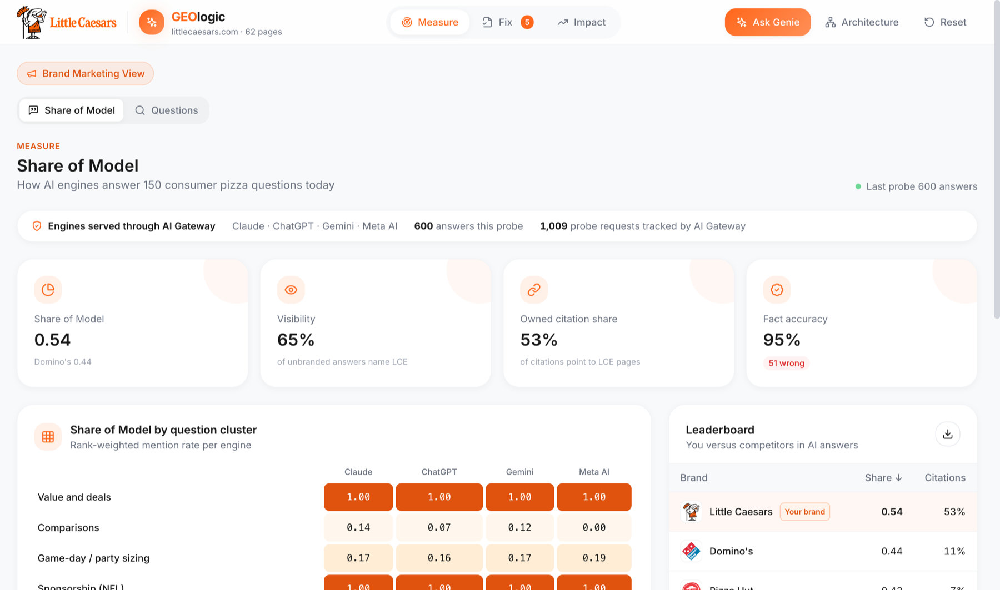
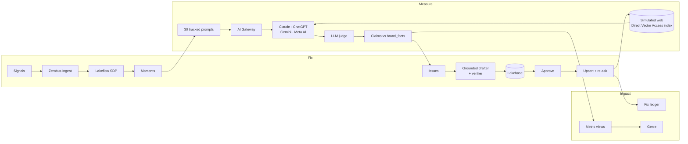

<p align="center">
  
</p>

<h1 align="center">GEOlogic</h1>

<p align="center">
  <b>When a guest asks an AI "what's the best bang for my buck pizza?", make sure the answer is Little Caesars, with the right facts.</b><br>
  A Generative Engine Optimization (GEO) demo on Databricks: measure what four AI answer engines say about the brand, fix the gaps with governed content, and prove the lift.
</p>

<p align="center">
  
  
  
  
  
  
  
</p>

<p align="center">
  
</p>

> [!IMPORTANT]
> **This is a demo built by Databricks for Little Caesars. It contains no Little Caesars customer or company data.** Every menu item, web page, review, social post, prompt volume and metric in this repo is synthetic, generated by the code in `src/geologic/datagen`. It is not a Little Caesars product and is not endorsed by Little Caesars. Brand names and logos belong to their owners; Jared Goff's name refers to Little Caesars' public NFL sponsorship, and every post attributed to him here is made up.

---

## ✨ What it does

| Tab | What you get |
|---|---|
| **Measure** | How four AI engines (Claude, ChatGPT, Gemini and Meta AI, all called through AI Gateway) answer **30 tracked prompts**: **Share of Model** (Share of Voice, weighted by rank), Visibility, Owned citation share and Fact accuracy (every claim checked against the `brand_facts` table in Unity Catalog), by engine and prompt cluster. **Ask anything** searches the tracked prompts; when nothing matches, **Track and run now** adds the prompt and asks all four engines on the spot. |
| **Fix** | A source audit of every issue the answers reveal: **Wrong**, **Outdated**, **Missing us**, **No answer page** and **Moment gap**. A T0 to T2 tier strip says what can ship on its own and what needs a human. Each fix is a grounded section patch with its checks shown; approve it into Lakebase and the engines are re-asked in under a minute. |
| **Impact** | The fix ledger (every approved fix with its before and after), the GEO funnel, leading and lagging indicators, and the Share of Model trend with a marker for each fix. |
| **Ask Genie** | A slide-over on every tab. Ask follow-up questions in plain English and see live phases, the generated SQL, a table and a chart. |

**The demo payoff:** approve the Party Pack fix and watch our page go from uncited to cited while the Outdated claim turns Correct.

## 🏗️ How it works



Databricks-hosted models don't browse the web and don't know the synthetic menu, so each engine answers through retrieval over a **simulated web**: a Direct Vector Access index of synthetic owned, competitor, editorial, community and reference pages. Approving a fix upserts the patched page into that index and re-asks the engines, so the before and after comes from the real system, not from scripted output.

## 🚀 Quick start

Everything deploys as one Declarative Automation Bundle (`databricks.yml` plus `resources/*.yml`) through `scripts/deploy.sh`. A few pieces are provisioned once by hand; [First-time setup](#first-time-setup) walks through them in order.

**Prerequisites**

- [Databricks CLI](https://docs.databricks.com/dev-tools/cli/install.html) v1.x, authenticated: `databricks auth login --profile DEFAULT`
- Node 18+ and npm (the frontend is built locally; only `app/frontend/dist` ships)
- `python3`, `psql` and `rsync` (used by the scripts)
- A workspace with Databricks Apps, serverless compute, Lakebase, Vector Search, AI Gateway, Zerobus Ingest and Genie

```bash
git clone https://github.com/jonathan-whiteley/geologic.git && cd geologic
TARGET=v3 bash scripts/deploy.sh               # build frontend, bundle src, guard, plan, deploy, start the app
TARGET=v3 SKIP_BUILD=1 bash scripts/deploy.sh  # reuse the existing app/frontend/dist
```

| Target | What it is |
|---|---|
| `v3` | This branch's demo stack (default): app `geologic-v3`, schema `geologic_v3`, jobs `geologic_v3_*`, Lakebase database `geologic_v3`. |
| `dev` | The earlier live demo. `deploy.sh` refuses it unless `ALLOW_V2_DEPLOY=1`, and only from its own branch. |

> [!WARNING]
> **Always deploy with `scripts/deploy.sh`.** A bare `databricks apps deploy` skips the env in `resources/app.yml` `config.env`, and the app starts without its catalog, Genie space or Lakebase settings.

Before anything is deployed, the guard (`scripts/check_plan.py`) checks:

1. **Resolved names:** the target's app, schema, jobs, pipeline and Lakebase database are its own (`bundle summary`).
2. **v2 ids:** no job, pipeline, dashboard, Genie space or serving endpoint of the earlier demo is named or bound.
3. **Bundle state app name:** the state records the same app name the target resolves to (a different one forces a destroy and recreate).
4. **Destructive plan actions:** the plan is refused if it is empty or deletes, recreates or replaces anything.

<a id="deploy-your-own"></a>

## 🔧 Deploy to your own workspace, catalog and schema

> [!IMPORTANT]
> **The committed defaults point at the reference demo workspace** (profile `DEFAULT`, catalog `jdub_demo`, schema `geologic_v3`, plus its warehouse and Lakebase host). Change them before you deploy anywhere else.

| Setting | Where | What to set |
|---|---|---|
| `catalog`, `schema` | `databricks.yml` variables and target `v3` | A schema you can create tables, volumes and functions in |
| `warehouse_id` | `databricks.yml` (or `WAREHOUSE_ID=` for `deploy.sh`) | A serverless SQL warehouse you can use |
| `lakebase_host`, `lakebase_db` | `databricks.yml` (or `LAKEBASE_HOST=`) | `read_write_dns` of your Lakebase instance and a database name |
| `genie_space_id` | `databricks.yml` target `v3` (or `GENIE_SPACE_ID=`) | The space `scripts/genie_space.py --create` prints; `none` means not configured |
| Workspace profile | `databricks.yml` `targets.*.workspace.profile` and `PROFILE` in the scripts | Your CLI profile |

Jobs read catalog, schema and Lakebase database from their task parameters (`--catalog`, `--schema`, `--lakebase-db`); the scripts read them from `databricks bundle summary`.

<a id="first-time-setup"></a>

### First-time setup in a fresh workspace

Do these in order, after the first `TARGET=v3 bash scripts/deploy.sh`.

1. **Lakebase database:** `python3 scripts/apply_lakebase.py --target v3 --create-db sql/lakebase_schema.sql` (the setup job's draft task writes fixes there).
2. **Setup job, `data` task:** `databricks bundle run geologic_setup -t v3 --profile DEFAULT`. The `data` task creates the schema, the `assets` volume and `bronze_signals`.
3. **Zerobus grant:** grant the Zerobus service principal `USE SCHEMA` on the schema and `SELECT, MODIFY` on `<catalog>.<schema>.bronze_signals`, and store `zb_endpoint`, `zb_client_id` and `zb_client_secret` in the secret scope `geologic`. On a brand new schema, `seed_signals` fails until this grant exists; repair the run afterwards.
4. **The rest of the setup job** (images, Vector Search indexes, the baseline probe, signals pipeline, views, history, issues, drafts and the answer-key check) runs on from the same run or its repair.
5. **Lakebase role for the app:** `python3 scripts/apply_lakebase.py --target v3 --grant-sp <APP_SP_CLIENT_ID>` (read it with `databricks apps get geologic-v3 -o json`, `service_principal_client_id`).
6. **Instance access:** `CAN_USE` on the Lakebase instance for the app service principal.
7. **Unity Catalog grants** for the app service principal: `USE CATALOG`; on the schema `USE SCHEMA, SELECT, MODIFY, EXECUTE`; on the `assets` volume `READ VOLUME`. `python3 scripts/apply_sql.py --target v3 --grant-app-sp <APP_SP_CLIENT_ID>` applies them.
8. **SQL objects:** `python3 scripts/apply_sql.py --target v3 sql/uc_functions.sql sql/metric_views.sql sql/gateway_views.sql` (UC functions, metric views and AI Gateway usage views). It sends statements through the SQL Statement API, which keeps metric view YAML indentation intact.
9. **Genie:** `python3 scripts/genie_space.py --target v3 --create`, grant the app service principal `CAN_RUN` on the space ACL (Genie spaces aren't bindable app resources), set the printed id as `genie_space_id` and deploy again.

## 🎬 Running the demo

1. **Warm up** 10 minutes before: open the app and ask Genie one question (a cold first call can take a few minutes).
2. **Morning rehearsal:** `python3 scripts/rehearse.py --target v3` approves the Party Pack fix, times approve to ledger, Resets and repeats; it exits 1 unless every run lands under 60 s.
3. **Reset** from the settings gear so the demo starts from the baseline.
4. **The three tabs:** Measure, then Fix (approve the Party Pack fix), then Impact.

| Bundle resource | Type | Purpose |
|---|---|---|
| `geologic` | App | The UI and API |
| `geologic_signals` | Pipeline | Lakeflow SDP signal pipeline |
| `geologic_setup` | Job | Full first-time build |
| `geologic_publish` | Job | Publish approved fixes (param `fix_ids`) |
| `geologic_reset` | Job | Return to the baseline |
| `geologic_produce` | Job | Stream synthetic signals through Zerobus (`inject`, `minutes`, `rate_per_min`) |
| `geologic_refresh` | Job | Every minute, created paused |
| `geologic_nightly` | Job | Re-embed the corpus, then the full probe; created paused |
| `geologic_verify_uc` | Job | One-off: verify the UC functions |

## 🧪 Tests

```bash
python3 -m venv .venv && .venv/bin/pip install -e '.[dev,databricks]'   # or: uv sync
.venv/bin/python -m pytest -q
cd app/frontend && npm ci && npm run build && npm run lint
```

The answer-key harness (`src/geologic/harness.py`, `jobs/answer_key_check.py`) checks the planted stories end to end against the live tables.

## 📁 Project structure

```
.
├── databricks.yml        bundle: variables and the v3 and dev targets
├── resources/            app, jobs and pipeline definitions
├── app/                  what ships to Databricks Apps
│   ├── main.py           FastAPI entry point
│   ├── backend/          routes, reads, search, fixes, Genie, Lakebase
│   └── frontend/         React + Vite UI (only dist/ is deployed)
├── src/geologic/         shared package: probe, judge, claims, issues, drafting, verify, tiering, publish flow
│   └── datagen/          synthetic menu, brand facts, simulated web, prompts, signals, answer key
├── jobs/                 setup, probe, publish, reset, produce, nightly and verification jobs
├── pipelines/            Lakeflow SDP signal pipeline
├── sql/                  tables, views, metric views, UC functions, gateway views, Lakebase schema
├── genie/                Genie space definition
├── dashboards/           AI/BI dashboard JSON (dev target only)
├── assets/photos/        photo credits (see ATTRIBUTION.md)
├── scripts/
│   ├── deploy.sh         build, guard, plan, deploy and start
│   ├── check_plan.py     the deploy guard
│   ├── push_photos.sh    uploads credited photos found locally to the volume
│   ├── apply_sql.py      SQL files and UC grants through the SQL Statement API
│   ├── apply_lakebase.py create the Lakebase database, apply its schema, grant the app role
│   ├── genie_space.py    create or update the Genie space
│   └── rehearse.py       time approve to ledger on the live app
├── docs/                 README screenshot
└── tests/
```

## 🩺 Troubleshooting

| Symptom | Fix |
|---|---|
| App starts but has no data, or Genie says "not configured" | It was deployed with a bare `databricks apps deploy`. Redeploy with `scripts/deploy.sh`. |
| `deploy.sh` stops: "App ... exists but this checkout has no bundle state" | Bind the existing resources first (`databricks bundle deployment bind ... -t v3`), then read `bundle plan`. |
| `deploy.sh` stops: "plan deletes or recreates resources" | A resource left the bundle or changed a force-new field. Remove it by hand (or unbind it), never by forcing the deploy. |
| Approve stays on step 3 | The Direct Access upsert was refused: the app service principal needs to own (or be granted on) the sources index. |
| Ask anything never matches | Matches need a Vector Search score of at least 0.80. Check the score `/api/search?q=...` returns for the text. |
| Impact shows "Rehearsed at" | The live re-ask passed 90 s, so the last rehearsal stands in. The live result lands when it is done. |
| Genie calls fail with `PermissionDenied` | Grant the app SP `CAN_RUN` on the Genie space ACL. No redeploy needed. |
| Lakebase writes fail with `permission denied for schema` | The app was recreated and has a new SP. Grant the new SP role (`scripts/apply_lakebase.py --grant-sp`). |
| First Genie answer takes minutes | Cold start. Ask one question 10 minutes before the demo. |
| Genie returns nothing for Domino's | Spark SQL reads `'Domino''s'` as `Dominos`; the space instructions use `concat('Domino', chr(39), 's')`. Update the space with `scripts/genie_space.py --update`. |
| Deploy hangs for 10+ minutes, then fails | `package.json` or `node_modules` reached the app source path and triggered an npm build. Keep the `sync.exclude` list in `databricks.yml`. |
| Metric view YAML parse error | Use `scripts/apply_sql.py`; some CLI helpers strip indentation. |

## 📝 About the data

All data is **synthetic**: a QSR menu, `brand_facts` with validity dates (so a claim can be Outdated, not just Wrong), a simulated web of owned, competitor, editorial, community and reference pages, 30 tracked prompts with modeled monthly search volume, and 7 planted stories that make the demo repeatable. The engine answers are generated live by real model families through AI Gateway, but only over that simulated web, so they reflect this repo's corpus, not what the public versions of those assistants say.

Jared Goff is the only athlete in the demo, and every post attributed to him is made up. The sportsbook account `@sidelinebets` and its repost are fictional; the repost is quarantined at ingest by a gambling policy rule and is never shown (the Fix tab shows a count and an audit trail only).

**None of it is Little Caesars data**, and no Little Caesars systems, accounts or customers were used to build it. The press photo used in the live demo is not included; a fresh setup draws a placeholder for it. Credits are in [`assets/photos/ATTRIBUTION.md`](assets/photos/ATTRIBUTION.md).

---

<p align="center">Made with ❤️ by Jonathan Whiteley at Databricks</p>
